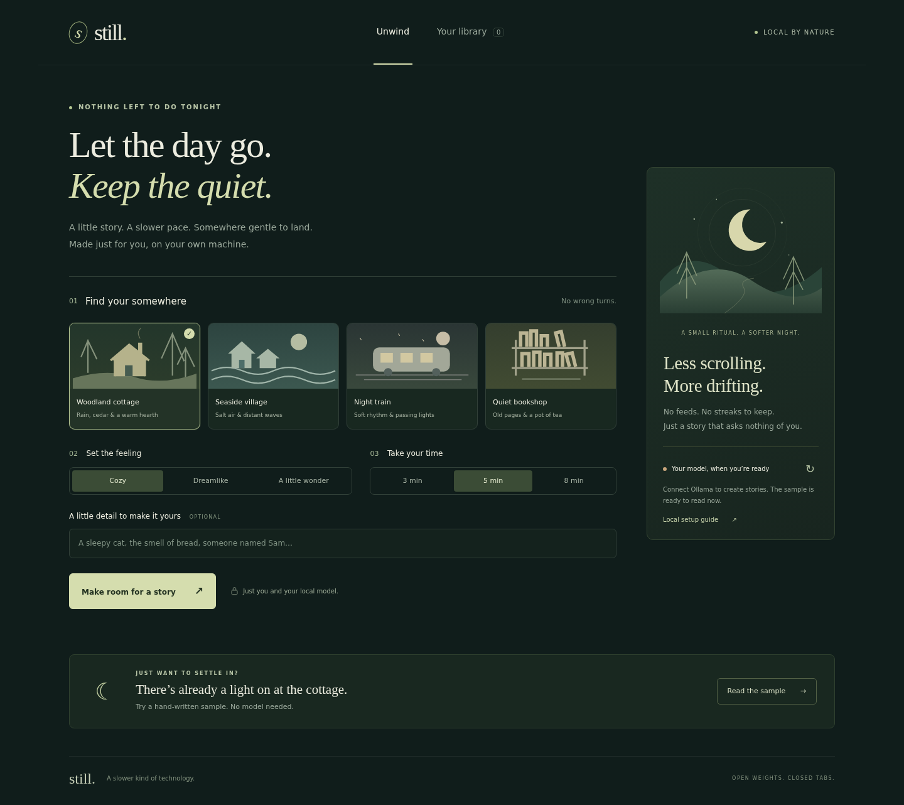

# Still

A softer end to your day. Still makes quiet bedtime stories with a local open-weight model, then gets out of the way.



## Run locally

Requires Python 3.10+ and [Ollama](https://ollama.com). No pip packages, frontend build, API keys, or accounts.

1. Install Ollama and download the model (internet required once):
   ```sh
   ollama pull qwen2.5:1.5b
   ```
2. Start Ollama if its desktop app is not already running:
   ```sh
   ollama serve
   ```
3. In this project's folder, start Still:
   ```sh
   python server.py
   ```
4. Open **http://localhost:3000**. The connection card should say **Local model connected**.
5. Pick a setting, a feeling, and a reading length. Add a detail if you like. Create a story.

On Windows, `py server.py` may be needed instead. For a loopback-only server on macOS/Linux, use `HOST=127.0.0.1 python server.py`. In PowerShell, set `$env:HOST="127.0.0.1"` first.

The model download is roughly gigabyte-scale; reserve several GB of available RAM. Runtime and quality depend on your machine. Start with a three-minute story. Lengths are targets, not guarantees. Reading time in the reader is estimated from the actual word count.

## What works

- Four illustrated settings: woodland cottage, seaside village, night train, quiet bookshop.
- Three moods, three target lengths, and an optional personal detail.
- Real Ollama HTTP integration; the model writes the story, not a template lookup.
- Automatic SQLite persistence, story library, deletion, and plain-text download.
- Focused reader with adjustable text size, keyboard-accessible dialogs, responsive layout.
- Model status, refresh, setup instructions, loading states, and useful errors.
- An explicitly labeled, prewritten sample for exploring the reader without a model. It is **not** passed off as generated output and is not added to the saved-story shelf.

## How it fits together

```
Browser → Python HTTP server → Ollama /api/generate → Qwen2.5 1.5B
                      ↘ SQLite (data/stories.sqlite3)
```

The browser only calls relative endpoints on the Still server. Python calls Ollama, defaulting to `http://127.0.0.1:11434`. The prompt sets the scene, mood, target word count, and a low-conflict narrative direction. Ollama JSON mode requests a title and body. The backend validates the result before writing it to SQLite. Story text is rendered with `textContent`, never injected as HTML.

The model supplies the core feature. Without it, you can read the sample or saved stories, but you cannot create new ones. No hosted inference fallback is used.

## Model choices

Default: [`qwen2.5:1.5b`](https://ollama.com/library/qwen2.5:1.5b), a small open-weight instruction model. The [Qwen2.5-1.5B-Instruct model card](https://huggingface.co/Qwen/Qwen2.5-1.5B-Instruct) lists Apache-2.0 licensing. [Ollama](https://github.com/ollama/ollama) supplies local inference under MIT. Model weights and their licenses are separate from this app's MIT license.

To try a larger model, install it and restart Still:

```sh
ollama pull qwen2.5:7b
STILL_MODEL=qwen2.5:7b python server.py
```

Available configuration: `HOST` (default `0.0.0.0` for hosted previews), `PORT` (`3000`), `STILL_MODEL` (`qwen2.5:1.5b`), `OLLAMA_URL` (`http://127.0.0.1:11434`). Set environment variables before starting the server. A changed model must support Ollama's generate endpoint and JSON output.

## Privacy and deployment boundaries

Run both Still and Ollama on your own computer for local-only generation. After downloading the software and model, the app requires no network resources: its fonts are system fonts, its artwork is inline SVG, and its scripts/styles are served locally. There is no analytics, CDN, login, or hosted AI dependency.

Stories are stored **unencrypted** in `data/stories.sqlite3` on the **server's** machine. If you host Still remotely, prompts travel to that server and saved stories live there, not on the viewer's laptop. A hosted preview cannot reach your laptop's Ollama instance.

This is a single-user local tool, not a hardened public service. There is no authentication, per-user separation, encryption at rest, rate limiting, or moderation layer. The default all-interface binding supports the development preview; for private use, bind to `127.0.0.1`. Do not expose it directly to the public internet. Prompts guide the tone but cannot guarantee every model output is soothing or suitable for every reader. This is not a medical or sleep-treatment product.

There are no per-story API charges. Hardware, power, and the initial download still have costs.

## Tests

```sh
python -m unittest discover -s tests -v
node --check static/app.js
```

Five backend tests cover successful generation with a mocked Ollama response, persistence/deletion, input validation, malformed output, and unavailable inference. They use a temporary database and do not need a model.

Optional UI smoke test (run the server in another terminal):

```sh
npm install --no-save --no-package-lock playwright
npx playwright install --with-deps chromium
node tests/browser.cjs
```

This checks the sample reader, text size, setting selection, unavailable-model error, empty shelf, setup dialog, and mobile overflow. It assumes Ollama is unavailable. Screenshots go to `docs/`.

**Verified in the build workspace:** backend tests, JavaScript syntax, desktop/mobile browser smoke test. **Not verified here:** real Qwen inference or offline generation on physical laptop hardware; Ollama was not installed. To verify locally, disconnect from the internet after downloading the model, generate a story, reload the library, download it, and delete it.

## Project files

- `server.py` — standard-library HTTP server, Ollama adapter, SQLite persistence
- `static/` — frontend, illustrations, sample story
- `tests/` — backend and optional browser tests
- `docs/` — desktop/mobile screenshots
- `submission.md` — DEV challenge submission draft
- `LICENSE` — MIT


